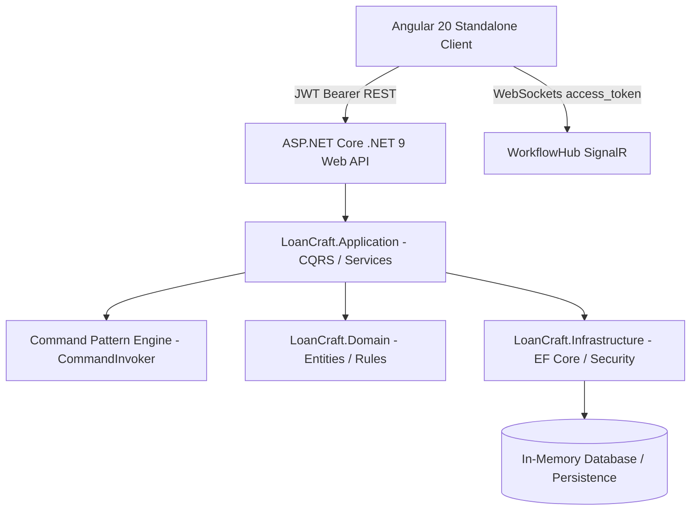

# ⚡ LoanCraft Studio

> **Enterprise Metadata-Driven Dynamic Forms & Distributed Workflow Execution Engine**  
> Built with **Angular 20 (Signals & Standalone Components)** and **ASP.NET Core (.NET 9 Clean Architecture)**.

---

## 🚀 Overview

**LoanCraft Studio** is a full-stack loan origination and underwriting platform designed around two core software architecture paradigms:
1. **Metadata-Driven Dynamic Form Engine**: Form fields and pipeline steps are defined as dynamic JSON models, allowing zero-code updates to credit questionnaires, input validation, and decision rules.
2. **Command Pattern Workflow Engine**: Underwriting evaluations are processed through an orchestrated pipeline of decoupled, executable commands (`CallRestApiCommand`, `MappingCommand`, `DecisionRuleCommand`, `ObjectMutationCommand`) streaming real-time execution telemetry to the client over **SignalR WebSockets**.

---

## 🏗️ Architecture & Tech Stack



### Frontend (`/LoanCraftApp`)
* **Framework:** Angular 20 (Standalone Components, Signals API)
* **Design:** Bespoke Modern Dark-Mode & Glassmorphic UI with 3-Panel Configurator Studio (Palette, Canvas, Dynamic Inspector)
* **Real-time:** `@microsoft/signalr` with automatic reconnection and JWT token factory
* **Security:** Angular Functional `authGuard` and HTTP `authInterceptor` injecting `Bearer <token>`

### Backend (`/LoanCraft`)
* **Framework:** .NET 9 Web API following **Clean Architecture** principles
* **Application Layer:** Dynamic Form Engine, `CommandInvoker` pipeline runner, `ILoanService`, `IUnderwritingService`, `IAuthService`
* **Infrastructure Layer:** EF Core In-Memory database, BCrypt password hashing, JWT Bearer Token Generator, SignalR `WorkflowHub`
* **API Documentation:** Swashbuckle OpenAPI 3.0 / Swagger with Bearer authorization lock

---

## 🔐 Authentication & Test Credentials

The backend automatically seeds an initial Underwriter development account upon startup:

| Field | Value |
| :--- | :--- |
| **Email** | `underwriter@loancraft.com` |
| **Password** | `Password123!` |
| **Role** | `Underwriter` |
| **Name** | `Lead Underwriter` |

*(The login screen also features an **Auto-fill Demo Credentials** button for instant one-click testing).*

---

## 📦 Getting Started

### 1. Prerequisites
* [.NET 9 SDK](https://dotnet.microsoft.com/download/dotnet/9.0)
* [Node.js](https://nodejs.org/) (v18+ or v20+)
* [Angular CLI](https://angular.dev/) (`npm install -g @angular/cli`)

---

### 2. Run the Backend (.NET 9 Web API)

```bash
cd LoanCraft/LoanCraft.API
dotnet run --launch-profile "https"
```

* **API Base URL:** `https://localhost:7199`
* **Swagger UI:** `https://localhost:7199/swagger`
* **SignalR Hub:** `https://localhost:7199/hubs/workflow`

---

### 3. Run the Frontend (Angular 20)

```bash
cd LoanCraftApp
npm install
npm start
```

* **Client URL:** `http://localhost:4200`
* Navigating to `http://localhost:4200` automatically directs unauthenticated users to `/login`.

---

## 📋 Features Breakdown

* 🎨 **Visual 3-Panel Configurator Studio**: Drag/click palette controls into the canvas, dynamically configure properties (label, validation, limits) in real-time.
* ⚡ **Live SignalR Pipeline Telemetry**: Trigger underwriting command sequences and inspect step-by-step telemetry events (`StepStarted`, `StepCompleted`, `WorkflowCompleted`).
* 🔒 **End-to-End JWT Auth**: Role-based access with JWT generation, password salting, client storage, and WebSocket query parameter handshake.
* 📊 **Telemetry Drawer**: Live visual drawer tracking execution duration, status pills, and payload metrics per loan run.

---

## 👤 Author

* **GitHub:** [@krijesh10](https://github.com/krijesh10)
